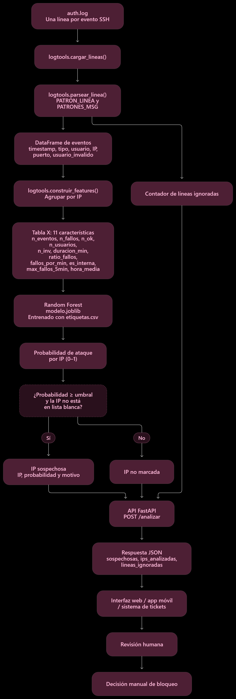

# Informe: auditoría del detector de intrusiones SSH

## 1. Qué hace el sistema
El detector lee el log de autenticación de un servidor SSH (srv-web01) y señala qué direcciones IP parecen atacantes. Convierte cada línea del log en un evento, resume lo que ha hecho cada IP en 11 números (fallos, usuarios distintos probados, velocidad, si es interna...) y un bosque aleatorio, entrenado con IPs ya etiquetadas, devuelve la probabilidad de que cada una sea un ataque. Con la API REST (FastAPI) otras aplicaciones lo usan y una interfaz web muestra la tabla de sospechosas con su motivo. El sistema solo informa: nunca bloquea.

## 2. Qué hemos descubierto
- **El resultado depende del reparto de datos.** En 10 repartos distintos el F1 va de 0.98 a 1.00 (E4): diferencias de 0.02 son ruido, no mejoras.
- **El umbral importa en los extremos.** Con 0.5 el F1 medio es 0.990 y no se cuela ningún atacante. Con 0.8 se escapan 15 atacantes en 10 repartos y con 0.95 el recall baja a 0.84 (E1).
- **Una regla simple no basta.** "N fallos en 5 minutos" no pasa de 0.59 de F1 frente a 1.00 del modelo, porque el 68 % de los atacantes son lentos y nunca superan 10 fallos (E3).
- **Con pocos ataques el resultado no es fiable.** Con solo 12 atacantes el recall cayó a 0.67 en 2 de 10 repartos (E6).
- **Sin etiquetas funciona mal.** IsolationForest llega como mucho a F1 0.87 y solo si se adivina que hay un 25 % de ataques; con 5 % deja pasar 80 de 100 atacantes (E7).
- **Muchas características son redundantes:** quitar una sola casi no cambia el F1 (E2). Otros modelos como el árbol o la regresión logística rinden parecido, aunque el árbol es más inestable (E8).

## 3. Hasta dónde fiarse
- **Datos sintéticos.** Los logs los genera un script con reglas fijas, así que los atacantes se comportan siempre igual. Con la semilla 999 el modelo mantiene F1 0.990, pero porque el generador es el mismo. Con logs reales, con ataques lentos o disfrazados, esperaríamos bastante menos.
- **Falsos positivos.** Un inocente marcado puede ser un compañero o un directivo; si se bloqueara de forma automática, perdería su acceso. Por eso la API solo informa y hay lista blanca.
- **Falsos negativos.** Los ataques lentos o repartidos entre cientos de IPs con pocos intentos cada una no se parecen a lo que el modelo aprendió y pasarían desapercibidos.
- **Características que dependen de cómo se generaron los datos.** `es_interna` supone que los ataques vienen siempre de fuera, y `n_ok` solo existe si el atacante consigue entrar (cuando ya es tarde). Un atacante interno o con credenciales robadas rompería esas pistas.
- **Cambios en las tácticas.** El modelo no se actualiza solo: si cambian los atacantes, hay que reentrenarlo.
- **Privacidad.** Las IP y los nombres de usuario del log son datos personales y hay que tratarlos según el RGPD: finalidad, minimización, conservación limitada.
- **Fiabilidad del número de acierto.** Un F1 de 1.000 sobre datos sintéticos no es una garantía.

## 4. Recomendación
No lo pondría en producción como sistema automático, pero sí como ayuda a los administradores, en modo "solo avisar":
- **Umbral:** 0.5 (o 0.3 si el servidor guarda datos sensibles), no el 0.7 por defecto. Es el que mejor resultado dio en E1.
- **Revisión humana:** una persona confirma cada aviso antes de bloquear y se mantiene una lista blanca de IPs conocidas (oficinas, directivos, servicios).
- **Monitorización:** registrar cuántos avisos se confirman y cuántos eran falsos, vigilar los ataques nuevos que el modelo no detecte y reentrenar con logs reales etiquetados.
- **Antes de abrirlo a Internet:** autenticación por clave de API, límite de peticiones, HTTPS y registro de peticiones sin guardar IPs en claro.

## 5. Esquema de la integración
Interfaz web (HTML + JavaScript, `index.html`) --fetch POST JSON--> API FastAPI (`api.py`) --usa--> `logtools.py` (parseo y características) y `modelo.joblib` (cargado una vez al arrancar) --> respuesta JSON con `sospechosas`, `ips_analizadas` y `lineas_ignoradas`. La app móvil o el sistema de tickets consumen la misma API. `GET /salud` comprueba que el servicio está vivo. Los errores usan 422 con `{"error": ..., "detalles": [...]}`.

